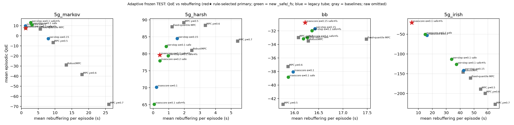
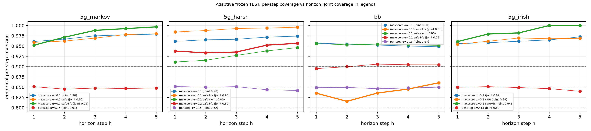
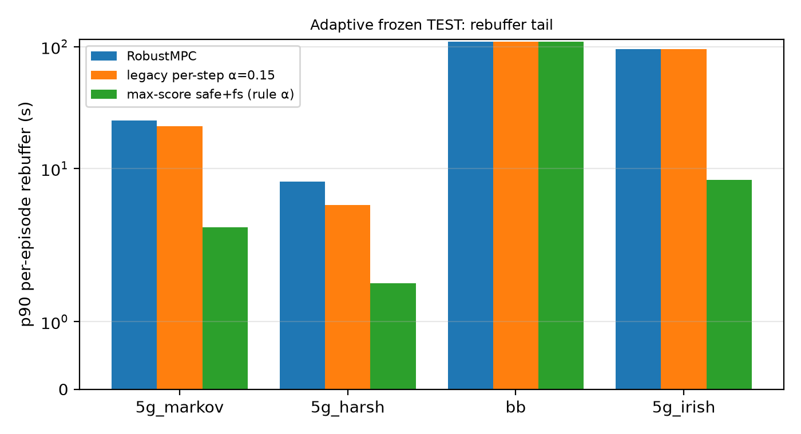

# CPS Paper 2 — Conformal Tube-MPC for Adaptive Bitrate Streaming

Code and results for Paper 2: **conformal perceptual shielding (CPS) extended to a horizon-wide conformal tube inside MPC** for ABR.
(Earlier project overview: `docs/README_legacy.md`; provenance: `NOTICE.md`.)

## Method
At each decision j, an MPC planner over horizon H uses **conformal lower bounds** on throughput for steps h=1..H
(step h of decision j is aligned with chunk j+h−1).
* **Per-step tube** (`step_static`): per-step conformal quantiles (Bonferroni over horizon; optional ACI, α ← α + γ(α_h − err)).
* **Max-score joint tube** (`maxscore`): one quantile of the normalised max score over the horizon → simultaneous (joint) coverage ≥ 1−α.
* **`_safe`** — planner constraint applied *before* refill at every horizon step: d_h(a,L) ≤ B^{(h−1)}(a,L) − margin on the lower bound;
  lowest bitrate fallback if no sequence qualifies (the legacy post-refill check was vacuous).
* **`_fs`** — frozen split calibration: σ_h fitted on even-indexed calibration traces, joint quantile on odd ones, both frozen online.
* **Main method:** `tube_v2_maxscore_a{α}_safe_fs` with **per-family α** chosen by the pre-registered rule.

Theory (theorem: joint coverage; lemma: conditional zero rebuffer): `docs/theory/tube_mpc_theory.tex`.

## Data splits
Disjoint **calib / val / test** splits defined in `configs/trace_manifests/canonical_traces.json`
(sha256 `0cd91b57…`, verified at run time). Calibration uses calib only; α selection uses val only; test is run once after freezing.
Families: `5g_markov`, `5g_harsh`, `bb`, `5g_irish`. Data setup: `docs/data_setup.md`.

## Pre-registered α rule
`configs/tube_v3_alpha_rule.yaml` (commit `e3593f8`, before any val run): pick the α with smallest QoE loss subject to
the 95% upper CI of the p90-rebuffer difference vs `robust_mpc_logu` being ≤ 0.25 s (trace-cluster bootstrap, B=4000).

## Reproduce
```bash
python3 -m venv .venv && . .venv/bin/activate && pip install -r requirements.txt
# 1) VAL (100 episodes/arm, all families)
python src/evaluation/run_tube_v3_adaptive_val.py --episodes 100
# 2) apply rule -> results/tube_v3/adaptive_val/alpha_selection.json
python src/evaluation/select_alpha_rule.py
# 3) FREEZE: configs/tube_v3_adaptive_final.yaml (commit 818629c, code f6727ef) — already committed, do not edit
# 4) single TEST run
python src/evaluation/run_tube_v3_final.py --config configs/tube_v3_adaptive_final.yaml --out results/tube_v3/adaptive_test
# 5) analysis / figures (args: results dir, previous-test dir, figure dir, report path)
python scripts/paper2/analyze_tube_v3_adaptive.py results/tube_v3/adaptive_test results/tube_v3/final_test \
    docs/figures/tube_v3_adaptive docs/reports/tube_v3_adaptive_test.md
```
Long runs: use `nohup` on a server (`docs/server_runs.md`). Seeds: master_seed 42; runs are deterministic.

## Statistics
Primary: **trace-cluster bootstrap** 95% CIs (B=4000) of differences vs RobustMPC; paired episode CIs reported alongside.

## Final results (frozen test, primary arm vs RobustMPC, cluster CIs)
| set | α | ΔQoE | Δrebuffer (s) | joint coverage (target) |
|---|---|---|---|---|
| 5g_markov | 0.10 | **+36.5** [+20.1, +53.5] | −12.05 [−15.50, −8.70] | 0.924 (0.90) |
| 5g_harsh | 0.20 | −1.4 [−7.3, +4.8] (n.s.) | **−2.05** [−2.97, −1.27] | 0.818 (0.80) |
| bb | 0.15 | +2.7 [+0.9, +4.5] | −0.06 [−0.35, +0.16] | **0.646 (0.85) — fails** |
| 5g_irish | 0.10 | **+124.8** [+40.1, +220.0] | −36.83 [−60.86, −14.85] | 0.936 (0.90) |

Full report: `docs/reports/tube_v3_adaptive_test.md` · tables: `docs/reports/tube_v3_adaptive_tables.md` · limitations: `docs/LIMITATIONS.md`





## Audit trail (branch `tube-v3-val`)
`0d9b582` `_safe`/`_fs` → `e3593f8` α rule → `f6727ef` runners → `818629c` freeze → `f154d8f` test report.
Earlier frozen test (`configs/tube_v3_final.yaml`, `938bf27`/`76059da`) kept untouched.

## Layout
`configs/` configs & manifests · `src/` policies, env, evaluation · `scripts/paper2/` analysis · `experiments/` launchers ·
`docs/` reports, figures, theory · `results/` outputs (large files not tracked) · `data/` traces (not in git)
