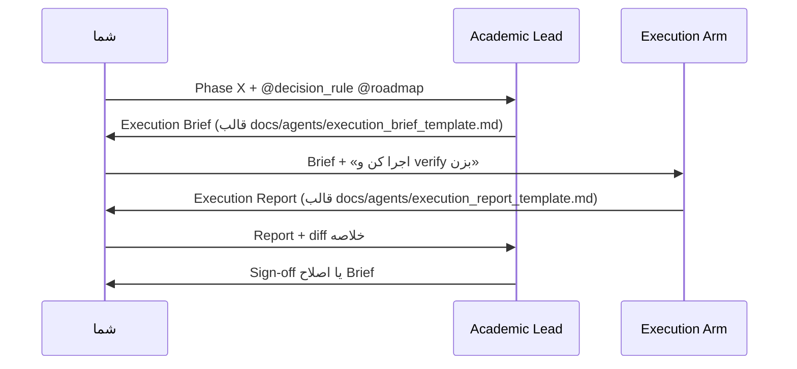

# Dual-Agent Workflow: CPS-Paper2 (V20)

این پروژه با **دو نقش جدا** پیش می‌رود: یک **معمار اکادمیک** (چت جدا، مشخصات و review) و یک **بازوی اجرایی** (Agent در Cursor، پیاده‌سازی و verify).

## نقش‌ها

| نقش | کجا | مدل پیشنهادی (مقرون‌به‌صرفه) | خروجی |
|-----|-----|------------------------------|--------|
| **Academic Lead (PI)** | چت جدید Composer/Chat؛ Plan فقط برای فازهای مبهم | **Composer 2.5** یا **Claude 4 Sonnet** / **GPT-5 mini** — از Opus و مدل‌های ultra/thinking پرهزینه استفاده نکن | `Execution Brief` برای هر فاز |
| **Execution Arm** | Agent همین ریپو (چت اجرا) | **Composer 2.5 Fast** یا همان Agent پیش‌فرض Cursor | کد + لاگ verify + `Execution Report` |

### انتخاب مدل (هزینه vs کیفیت)

- **Academic Lead:** کیفیت مشخصات و checklist مهم است؛ یک مدل **mid-tier** معمولاً کافی است چون roadmap و `decision_rule` زمینه را می‌دهند. فقط برای یک **RFC علمی** (مثلاً تغییر α یا تعریف arm) یک بار Plan یا مدل کمی قوی‌تر — نه برای هر فاز.
- **Execution Arm:** بیشتر خواندن template، diff کوچک، و shell — **Fast** ارزان‌تر و برای فازهای ۱–۳ اغلب بهتر از مدل گران.
- **قانون عملی:** اگر Brief واضح است → Fast اجرا؛ اگر review آماری یا اختلاف با roadmap → Sonnet / Composer 2.5 در چت Academic.

## حلقهٔ کار (یک فاز)



## شروع سریع

### ۱) چت Academic Lead

1. چت **جدید** باز کنید؛ مدل را روی **Composer 2.5** یا **Sonnet / GPT-5 mini** بگذارید (نه Opus).
2. محتوای [`academic_lead_system_prompt.md`](./academic_lead_system_prompt.md) را در اولین پیام paste کنید (یا به‌عنوان Custom Instruction همان چت).
3. بنویسید:

```text
@docs/clean_slate_abr.md @docs/reports/clean_v3_full_metrics.md
فاز بعدی را باز کن: Execution Brief بده؛ هنوز کد ننویس.
```

### ۲) چت Execution Arm

1. در Agent این ریپو rule را فعال کنید: `.cursor/rules/cps-paper2-execution-arm.mdc` (یا `@` همان rule).
2. **Execution Brief** را از چت Academic کپی کنید.
3. بنویسید:

```text
این Execution Brief را اجرا کن؛ فقط محدودهٔ Brief؛ در پایان verify و Execution Report.
```

### ۳) بازگشت به Academic

```text
Execution Report فاز X را review کن. Sign-off بده یا Brief اصلاح‌شده برای iteration بعد.
```

## اسناد مرجع (هر دو نقش)

- [`docs/clean_slate_abr.md`](../clean_slate_abr.md) — محیط و کمپین `clean_v3`
- [`docs/reports/clean_v3_full_metrics.md`](../reports/clean_v3_full_metrics.md) — نتایج headline
- [`docs/server_runs.md`](../server_runs.md) — اجرا روی سرور

## قوانین غیرقابل مذاکره (هر دو نقش)

- `paper_v1/` **frozen** — فقط خواندن و cite template
- seed جفت‌شده: `1000 + ep` در همهٔ arms
- پایهٔ env: `configs/videos.py`, `abr_multi_env_v18.py`

## قالب‌ها

- [`execution_brief_template.md`](./execution_brief_template.md) — خروجی Academic Lead
- [`execution_report_template.md`](./execution_report_template.md) — خروجی Execution Arm
